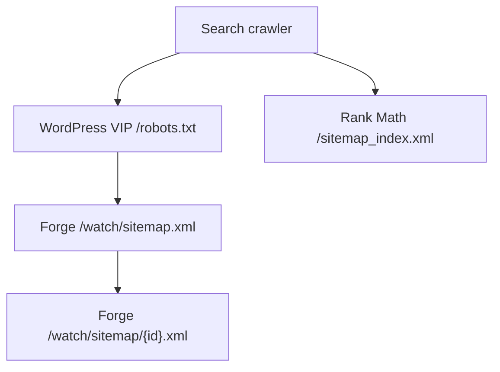

# Restore Watch root sitemap discovery

## Summary

Advertise the healthy Forge Watch sitemap index once from the authoritative public WordPress `/robots.txt`. The root Rank Math index will remain unchanged because sitemap indexes cannot contain other sitemap indexes.

---

## Problem Frame

`https://www.jesusfilm.org/watch/sitemap.xml` and its shards return valid XML from the Forge Watch application, but crawlers are not directed to them from the canonical host root. Live responses on 2026-07-23 show that WordPress VIP owns `/robots.txt` and Rank Math owns `/sitemap_index.xml`; neither response references the Watch sitemap. The base-path-scoped `/watch/robots.txt` cannot establish host-level crawler policy.

FGE-18 originally proposed adding the Watch index to Rank Math's index. Google rejects nested sitemap indexes, so the protocol-valid repair is a direct root robots directive. This plan resolves crawler discovery at the root-site owner without changing or duplicating the Watch sitemap.

---

## Requirements

- R1. The public root `/robots.txt` contains exactly one valid `Sitemap: https://www.jesusfilm.org/watch/sitemap.xml` directive while preserving all unrelated crawler rules.
- R2. A non-public WordPress site leaves its generated robots output unchanged.
- R3. Rank Math's root sitemap index does not contain the nested Watch sitemap index and remains otherwise unchanged.
- R4. Reapplying the robots filter or receiving pre-existing duplicate Watch directives produces one canonical Watch sitemap directive.
- R5. The canonical Watch sitemap URL is static and does not depend on the request host, environment, or `/watch/robots.txt`.
- R6. Automated tests cover hook registration, canonicalization, preservation, privacy behavior, and exact-once behavior.
- R7. Post-deployment evidence confirms the root robots directive and that the Watch sitemap index and a shard remain successful XML responses without redirects.

---

## Scope Boundaries

- The WordPress theme federates the Watch sitemap URL; it does not fetch, proxy, parse, or reproduce Watch XML.
- The Forge sitemap manifest, sitemap routes, locale URLs, canonicalization, and `/watch/robots.txt` are unchanged.
- Cloudflare and Railway routing are unchanged unless deployment verification reveals a new routing failure.
- Rank Math's sitemap index is unchanged because adding the Watch index would create a crawler-invalid nested sitemap index.
- No Rank Math or Yoast sitemap hook is registered.
- The pull request does not directly deploy or promote the WordPress VIP production application.

---

## Key Technical Decisions

- KTD1. **Implement in `JesusFilm/jesus-film-www`:** WordPress VIP owns both authoritative root discovery responses, while the Forge Next.js application is constrained by its `/watch` base path.
- KTD2. **Use the WordPress `robots_txt` filter at priority 99 with two accepted arguments:** This is the supported root extension point, and the late priority runs after Rank Math's robots customization at priority 10.
- KTD3. **Only advertise the sitemap when `$public` is true:** A site with WordPress search-engine visibility disabled must retain its restrictive crawler policy unchanged. Public non-production environments must set that standard WordPress option correctly before using this production-host directive.
- KTD4. **Do not nest the Watch sitemap index inside Rank Math's index:** Google accepts sitemap files, not other sitemap indexes, as children of a sitemap index. Root robots can advertise multiple sitemap indexes directly.
- KTD5. **Canonicalize complete robots directives rather than raw URL occurrences:** Remove only lines that are valid Watch `Sitemap:` directives, preserve unrelated lines including comments that mention the URL, and append one canonical directive.
- KTD6. **Separate declarations from registration:** Production bootstrap loads the declarations and calls a registration function once, while Brain Monkey tests can load the declarations once and invoke registration after each setup without redeclaring callback functions.
- KTD7. **Treat deployed HTTP output as the acceptance boundary:** Unit tests prove callback behavior, but only production checks can prove WordPress VIP caching and the host/path split to Railway.

---

## High-Level Technical Design

The WordPress theme contributes one canonical Watch directive to root robots. Crawlers then cross the existing routing boundary to Forge, which remains the sole producer of the Watch sitemap index and shards. Rank Math's root index continues to enumerate WordPress sitemap files only.

---

## Implementation Units

### U1. Add root robots discovery

- **Goal:** Register and canonicalize the Watch sitemap directive in public WordPress robots output.
- **Files:**
  - Create `lib/functions/robots.php`.
  - Modify `lib/init.php`.
- **Approach:** Follow the existing namespaced function pattern under `lib/functions/`. Keep declarations free of top-level hook side effects, expose a registration function, and have production bootstrap call it once after loading the file. For public sites, remove complete Watch sitemap directive lines and append one canonical directive; preserve all unrelated rules and comments. For non-public sites, return the original output unchanged.
- **Requirements:** R1, R2, R3, R4, R5.
- **Test scenarios:**
  - Public robots content without a trailing newline gains one well-formed sitemap directive.
  - Existing robots rules and comments remain in order before the appended directive.
  - Private robots content remains unchanged.
  - Duplicate valid Watch directives collapse to one.
  - A comment or malformed line containing the Watch URL does not suppress the valid directive.
  - Repeated callback application remains exact-once.
- **Verification:** Production bootstrap registers `robots_txt` at priority 99 with two accepted arguments and does not register a sitemap-index filter.

### U2. Add focused unit coverage

- **Goal:** Lock the cross-plugin contract and exact-once behavior into the repository's Brain Monkey test suite.
- **Files:**
  - Create `tests/phpunit/unit/lib/functions/class-robots.php`.
- **Approach:** Load declarations once, invoke the registration function after each Brain Monkey setup, and call the robots callback directly with representative inputs. Assert a complete directive line occurs exactly once rather than counting bare URL substrings.
- **Requirements:** R1, R2, R3, R4, R5, R6.
- **Test scenarios:**
  - Registration expectations match the WordPress hook contract.
  - Empty, populated, private, and already-federated robots inputs produce the required output.
  - Duplicate directives are repaired, while comments and malformed lines containing the URL remain unrelated input.
  - One complete canonical directive occurs after initial and repeated application.
  - Existing unrelated rules retain their content and order.
- **Verification:** The unit suite, WordPress coding-standard checks, and PHPCompatibility checks for PHP 5.6 syntax pass with no warnings introduced by the new production file.

### U3. Verify the promoted root discovery contract

- **Goal:** Record production evidence that the root robots change is live and the cross-host sitemap chain is healthy.
- **Owner:** The WordPress VIP release owner with production promotion and cache-invalidation access.
- **Trigger:** The theme artifact containing U1 and U2 is promoted to the JesusFilm.org production application.
- **Approach:** Confirm the promoted theme and active Rank Math robots customization still execute the WordPress filter, invalidate the WordPress VIP root robots cache through the established production process, then poll within the existing four-hour cache window.
- **Requirements:** R1, R3, R7.
- **Verification:** Attach response status, content type, redirect history, exact directive count, root/Watch ownership headers, Watch index parsing, and one shard check to FGE-18. Close the issue only after all checks pass; roll back the theme promotion if crawler policy changes unexpectedly.

---

## System-Wide Impact

- **Crawler entry points:** Root robots consumers gain a path to the Watch sitemap index; no end-user page behavior changes.
- **Ownership boundary:** WordPress owns discovery references, and Forge continues to own sitemap data and rendering.
- **Failure behavior:** If the Watch sitemap is unavailable, the root references remain stable and expose the existing Forge failure response rather than masking it through WordPress.
- **Caching:** Root robots may remain cached by WordPress VIP for up to four hours.
- **Performance:** The filters perform only in-memory string checks and appends. They introduce no network or database work.

---

## Risks and Dependencies

- **Robots customization order:** Rank Math or another plugin can replace robots output before this callback. Mitigation: register at priority 99 and assert the final deployed response.
- **Duplicate ownership outside the theme:** Another callback could advertise the same URL. Mitigation: canonicalize matching directive lines late and verify the final rendered response contains one occurrence.
- **Cache-delayed acceptance:** A correct release may not appear immediately at `/robots.txt`. Mitigation: invalidate the WordPress VIP URL cache during promotion, or wait for the documented cache window before declaring failure.
- **Separate production promotion:** Merging this repository updates the theme artifact flow but does not itself prove VIP production promotion. Mitigation: keep FGE-18 open until the deployed HTTP acceptance checks pass.

---

## Documentation and Operational Notes

After the theme is promoted, the WordPress VIP release owner invalidates the root robots cache through the established production process. Verify:

- root robots contains the Watch sitemap directive exactly once;
- root sitemap index does not contain the nested Watch sitemap index;
- root responses still terminate at WordPress VIP;
- `/watch/sitemap.xml` and one referenced shard return `200` XML without redirecting and still terminate at Railway;
- the root discovery surfaces do not depend on `/watch/robots.txt`.

Search Console and Bing submission or recrawl evidence remains an operational follow-through after the HTTP contract is live.

---

## Sources and References

- Linear issue [FGE-18](https://linear.app/jesus-film-project/issue/FGE-18/p0-restore-canonical-watch-sitemap-and-crawler-discovery).
- [WordPress `robots_txt` filter](https://developer.wordpress.org/reference/hooks/robots_txt/).
- [Google Search Console nested sitemap index error](https://support.google.com/webmasters/answer/7451001#nested_sitemap).
- [Google sitemap index guidance](https://developers.google.com/search/docs/crawling-indexing/sitemaps/large-sitemaps).
- [Google robots.txt guidance](https://developers.google.com/crawling/docs/robots-txt/create-robots-txt).
- [WordPress VIP robots.txt guidance](https://docs.wpvip.com/security-controls/robots-txt/).
- Forge repository: `apps/web/src/app/robots.ts`, `apps/web/src/app/sitemap.xml/route.ts`, `apps/web/src/app/sitemap/[id]/route.ts`, and `apps/web/src/lib/watch-sitemap.ts`.
- Forge repository: `docs/solutions/performance-issues/watch-hreflang-sitemap-manifest-20260612.md`.
- Theme repository: `.github/workflows/deploy.yml`, `lib/init.php`, `lib/plugins/gravity-forms.php`, `composer.json`, and `tests/phpunit/unit/class-test-case.php`.
